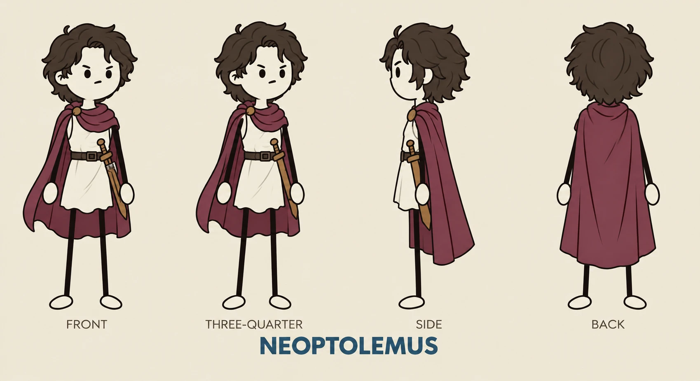

# NHÂN VẬT NGƯỜI KỂ CHUYỆN: NEOPTOLEMUS

> Nhân vật dẫn chuyện **cố định cho MỌI video** của kênh. Không thay trang phục, màu sắc hay tỉ lệ cơ thể giữa các video.
> Bản thiết kế tham chiếu (4 góc nhìn): [`assets/characters/neoptolemus-turnaround.webp`](assets/characters/neoptolemus-turnaround.webp)
>
> ⚠️ **Thanh kiếm gỗ ở hông trong ảnh tham chiếu đã bị BỎ.** Neoptolemus **không mang kiếm hay bất kỳ vũ khí nào**. Mọi hình mới đều phải vẽ không có kiếm. Prompt bên dưới đã ghi rõ điều này.



---

## 1. Đặc điểm nhận dạng (KHÓA CỨNG, không đổi)

| Bộ phận | Mô tả |
|---|---|
| **Phong cách vẽ** | Hoạt hình 2D nét đơn giản, viền đen dày đều, tô màu phẳng, không đổ bóng gắt. Thân hình "người que" (stick figure) |
| **Đầu** | To so với thân (khoảng 1/3 chiều cao), mặt trắng ngà, không có mũi |
| **Tóc** | Nâu sẫm, xoăn bồng, rối, dài ngang cằm; có vài lọn dựng trên đỉnh đầu |
| **Mắt** | Hai chấm đen tròn nhỏ; lông mày đậm, xếch xuống (vẻ cau có/nghiêm nghị mặc định) |
| **Miệng** | Một nét gạch ngang ngắn |
| **Áo** | Áo chiton/tunic trắng ngà, không tay, gấu áo răng cưa nhẹ, dài tới giữa đùi |
| **Thắt lưng** | Da nâu sẫm, khóa vuông. **Không đeo gì ở thắt lưng** |
| **Áo choàng** | Đỏ rượu vang (burgundy), quàng qua vai thành lớp khăn cuộn quanh cổ, cài bằng **trâm tròn màu đồng** ở vai; buông dài tới bắp chân |
| **Vũ khí** | **KHÔNG CÓ.** Không kiếm, không khiên, không giáo |
| **Tay** | Que đen mảnh, bàn tay là hình bầu dục trắng (không ngón) |
| **Chân** | Que đen mảnh, bàn chân là hình bầu dục trắng |

### Bảng màu tham chiếu (gần đúng)
| Vùng | Màu | HEX |
|---|---|---|
| Nền khuyến nghị | Be giấy cũ | `#EFE6D6` |
| Da / mặt | Trắng ngà | `#FBF6EC` |
| Tóc | Nâu sẫm | `#3B2A20` |
| Áo tunic | Kem | `#F4EEDF` |
| Áo choàng | Đỏ rượu vang | `#7E2F45` |
| Trâm cài | Đồng | `#B87333` |
| Thắt lưng | Nâu da | `#4A3426` |
| Nét viền / tay chân | Đen nâu | `#1E1714` |
| Chữ tiêu đề tên | Xanh thép | `#25506E` |

---

## 2. Vai trò trong video
- **Neoptolemus là "người kể"**: xuất hiện ở góc màn hình (thường là góc dưới trái hoặc dưới phải) khi lời dẫn nói trực tiếp với khán giả: mở đầu, câu deadpan, "Nhớ lấy chi tiết này", câu chốt cuối và CTA.
- **Không xuất hiện trong tiểu phẩm hội thoại** của nhân vật lịch sử (trừ khi cố ý phá "bức tường thứ tư" để bình luận).
- Tính cách: tỉnh queo, hơi cau có, nói ngắn. Hài kiểu deadpan; không bao giờ cười toe hay làm trò lố.
- Biểu cảm mặc định là **cau mày nghiêm nghị**. Chỉ đổi biểu cảm ở các khoảnh khắc chủ đích (xem bảng dưới).

### Bộ biểu cảm / tư thế chuẩn
| Mã | Khi nào dùng | Mô tả |
|---|---|---|
| `N-IDLE` | Mặc định khi kể | Đứng thẳng, cau mày, tay buông |
| `N-POINT` | "ngay đây", "nhìn vào bản đồ" | Một tay chỉ về phía bản đồ/hình |
| `N-DEADPAN` | Câu bình luận tỉnh queo | Nhìn thẳng ống kính, mắt khép hờ, miệng gạch ngang |
| `N-SHRUG` | "Thật đấy.", "Ừ, chỉ một [X]." | Nhún vai, hai tay ngửa |
| `N-WARN` | "Nhớ lấy chi tiết này…" | Giơ một tay lên, lông mày nhướng |
| `N-SAD` | Khoảnh khắc con người / bi kịch | Cúi đầu nhẹ, lông mày hạ, áo choàng rủ |
| `N-SHOCK` | Cú đảo bất ngờ | Mắt to hơn một chút, miệng chữ "o" nhỏ |
| `N-CTA` | Lời kêu gọi đăng ký cuối video | Đứng nghiêng ¾, tay chỉ về nút đăng ký/video tiếp theo |

---

## 3. Prompt tạo ảnh (giữ nhân vật đồng nhất)

Đính kèm ảnh `neoptolemus-turnaround.webp` làm ảnh tham chiếu nhân vật (character reference), rồi dùng prompt sau và chỉ thay `[TƯ THẾ / BIỂU CẢM]` và `[BỐI CẢNH]`. Ảnh tham chiếu vẫn còn thanh kiếm, nên **luôn giữ câu "no sword"** trong prompt và negative prompt.

```
Neoptolemus, the recurring narrator character. Simple 2D cartoon, thick even black outlines, flat colors, no gradients. Stick-figure body with thin black limbs, white oval hands and feet with no fingers. Large head (about 1/3 of body height), ivory-white face, no nose, two small round black dot eyes, thick dark eyebrows angled down in a stern frown, short flat line mouth. Messy curly dark-brown chin-length hair with a few strands sticking up on top. Sleeveless cream-white Greek tunic with slightly jagged hem to mid-thigh, dark brown leather belt with square buckle and nothing hanging from it. Burgundy wine-red cloak draped over the shoulders, wrapped like a scarf around the neck, fastened with a round bronze brooch at the shoulder, falling to the calves. He carries NO sword and NO weapon of any kind; his hips are empty.
Pose / expression: [TƯ THẾ / BIỂU CẢM]
Background: [BỐI CẢNH, mặc định: plain warm parchment beige #EFE6D6]
Keep the same face, hair, outfit, proportions and colors as the reference sheet, but remove the sword. No text, no extra accessories, no helmet, no armor, no shading.
```

**Negative prompt (nếu công cụ hỗ trợ):**
```
sword, wooden sword, dagger, scabbard, weapon, shield, spear, helmet, armor, realistic, 3D, anime, detailed fingers, nose, open smile, teeth, different hair color, blue cloak, gradient shading, extra limbs, text, watermark
```

---

## 4. Checklist trước khi dùng một hình Neoptolemus mới
- [ ] **Không có kiếm/vũ khí ở hông hay trên tay**
- [ ] Tóc nâu sẫm xoăn rối, không đội mũ
- [ ] Áo choàng đúng màu đỏ rượu vang, có trâm đồng tròn ở vai
- [ ] Tunic kem + thắt lưng nâu (trống, không đeo gì)
- [ ] Tay chân là que đen mảnh, bàn tay/chân bầu dục trắng
- [ ] Không có mũi; mắt là 2 chấm đen
- [ ] Nét viền và độ dày giống bản gốc
